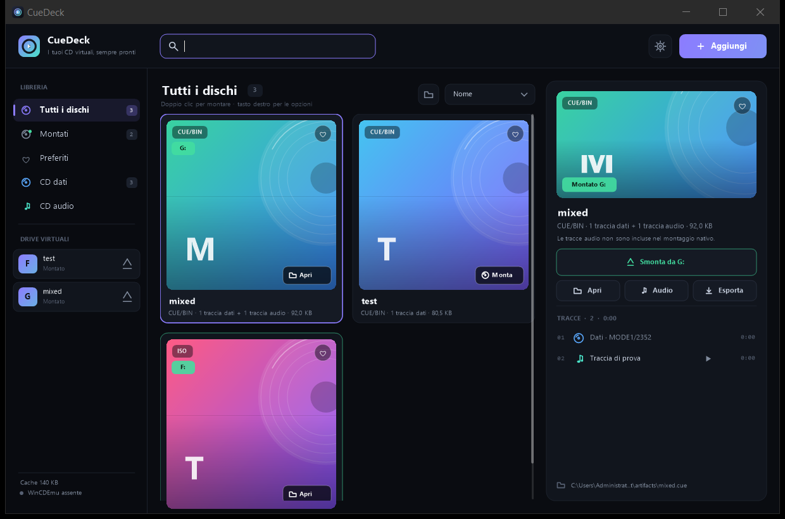
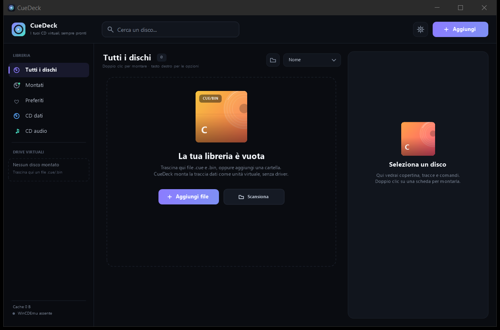
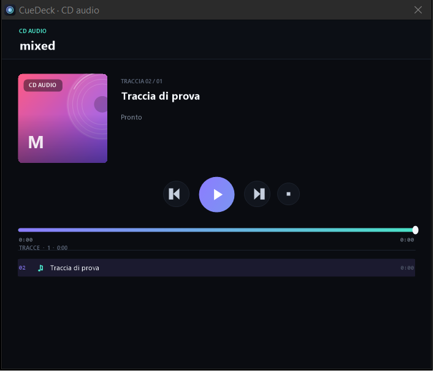

<p align="center"><a href="README.md">🇮🇹 Italiano</a> · <b>🇬🇧 English</b></p>

# CueDeck

**The virtual CD library and mounter for Windows.** CueDeck opens `.cue` + `.bin` files (and `.iso` images) as virtual CD drives, without installing drivers and without administrator rights for data CDs.

> The application UI is currently in Italian. This guide quotes the Italian labels so you can match them on screen, with the English meaning where useful.




## Contents

- [Features](#features)
- [Requirements](#requirements)
- [Download and launch](#download-and-launch)
- [Quick start](#quick-start)
- [How mounting works](#how-mounting-works)
- [CUE/BIN ↔ ISO conversion](#cuebin--iso-conversion)
- [Native mode vs full mode](#native-mode-vs-full-mode)
- [Supported formats](#supported-formats)
- [Interface guide](#interface-guide)
- [Audio CDs](#audio-cds)
- [Keyboard shortcuts](#keyboard-shortcuts)
- [Command line](#command-line)
- [Data, cache and privacy](#data-cache-and-privacy)
- [WinCDEmu (optional)](#wincdemu-optional)
- [Troubleshooting](#troubleshooting)
- [Known limitations](#known-limitations)
- [Build from source](#build-from-source)
- [Project structure](#project-structure)
- [Tests](#tests)
- [Roadmap](#roadmap)
- [License and credits](#license-and-credits)

## Features

- **Native data CD mounting.** The data track of a `.cue`/`.bin` is converted to an ISO in the cache and attached through the Windows Virtual Disk API (`virtdisk.dll`). No third-party driver, no service, no reboot.
- **Multiple virtual CDs at once.** Each mounted disc gets its own drive letter, so you can keep several games or archives available like with a real CD drive.
- **A proper library.** Drag files into the window, search, filter data/audio discs, sort, mark favourites, set a cover, and rename discs.
- **Built-in audio CD support.** Audio CDs have no file system to mount: CueDeck reads the tracks from the CUE/BIN, plays them in the integrated player, and exports them to WAV.
- **CUE/BIN ↔ ISO conversion.** Export the data track of a CUE/BIN to ISO, or generate a `MODE1/2352` CUE/BIN with sync, header, EDC and ECC from an ISO, directly in the app.
- **Tray and single instance.** Closing the window keeps CueDeck in the tray with the mounted discs alive. One instance handles every file opened from Explorer.
- **Managed cache.** Temporary ISOs and audio previews live in `%LOCALAPPDATA%\CueDeck` and can be cleared from Settings.
- **Small and portable.** A single `.exe` of about 224 KB, .NET Framework 4.8 (included in Windows 11), no external dependencies.
- **No telemetry.** CueDeck never contacts a server: the library and settings stay on your PC.

## Requirements

| Component | Requirement |
|---|---|
| OS | Windows 10 or Windows 11 (64-bit recommended) |
| Runtime | .NET Framework 4.8 or 4.8.1 (included in Windows 11) |
| Permissions | No admin for native data CD mounting |
| Space | About 1 MB for the app; ISO cache depends on mounted discs |
| Driver | None for native mode; WinCDEmu optional for full mode |

## Download and launch

### Compiled build

- **`dist/CueDeck.exe`** — portable application, no installation.
- **`dist/CueDeck-1.1.zip`** — archive with the exe, README (IT/EN), licence and screenshots.
- **[Releases](https://github.com/FSMaker77/CueDeck/releases)** — release `v1.1.0` provides the same files as individual downloads.
- **SHA-256 hashes** — in `dist/SHA256SUMS.txt` and in the release assets.

CueDeck is portable: copy `CueDeck.exe` wherever you like. The library and settings are stored in `%LOCALAPPDATA%\CueDeck`, not next to the exe.

> The executable is not digitally signed. If Windows SmartScreen shows a warning, choose **More info → Run anyway**. The full source code is in this repository.

### First launch

1. Open `CueDeck.exe`.
2. Drag one or more `.cue`/`.bin` files (or `.iso`) into the window.
3. Double-click a card to mount the disc.
4. Open the drive from the card, the sidebar, or the confirmation toast.



## Quick start

### Add discs

You can use any of these methods:

- drag files into the window;
- use **Aggiungi → Aggiungi file…** (`Ctrl+O`);
- use **Aggiungi → Aggiungi cartella…** to scan a folder (up to 5 levels deep);
- open a file from Explorer with `CueDeck.exe --mount "file.cue"`.

When you add a `.cue`, CueDeck automatically finds the `.bin` referenced by the sheet. If you add a `.bin` that has a `.cue` in the same folder, the CUE is used.

### Mount a disc

- **Double-click** a card: mount the disc (or open the drive if already mounted).
- **Monta disco** in the right panel: mount the data track.
- **Apri** on the card/right panel: open the mounted drive.
- **Smonta da X:** in the right panel: unmount the selected disc.

To unmount everything: **Aggiungi → Smonta tutti**, or the eject icon next to each drive in the sidebar.

### Multiple discs at the same time

Each mount creates a separate CD-ROM drive with a free drive letter (for example `F:` and `G:`). The **Drive virtuali** section in the sidebar lists every active drive; from there you can open or eject each disc.

### Search, filter, organise

- **Search** at the top (`Ctrl+F`): searches titles, file names, performers and track titles already read.
- **Filters**: All discs, Mounted, Favourites, Data CDs, Audio CDs.
- **Sort**: Name, Recent, Recently mounted, Size.
- **Favourites**: heart on the card or `Space`.
- **Cover**: right-click → *Imposta copertina…* (JPG/PNG/BMP/GIF).
- **Rename**: right-click → *Rinomina…* or `F2`.
- **Reveal in file system**: opens Explorer at the source file.

### Close and tray

With the default option, the **X** hides CueDeck in the tray and keeps discs mounted. Double-click the tray icon to reopen it. You can disable this in **Settings**. To really quit, use the tray menu → **Esci**.

## How mounting works

A CUE/BIN is a raw-sector CD image. For a data CD CueDeck:

1. parses the CUE and finds the data track;
2. extracts the 2048 user bytes of each sector into the ISO cache;
3. attaches the ISO to Windows through `virtdisk.dll`;
4. keeps the disc attached while CueDeck is running.

The cache is in `%LOCALAPPDATA%\CueDeck\Cache`. The first mount converts the disc; later mounts are instant until the source or CUE changes.

## CUE/BIN ↔ ISO conversion

CueDeck can convert discs directly from the UI, without external tools.

### CUE/BIN → ISO

1. right-click the disc card (or use the **ISO** button in the right panel);
2. choose **Converti in ISO…**;
3. choose the destination ISO file.

Only the **data track** is extracted and a mountable ISO is produced. If the disc has audio tracks they are not included: the ISO contains only the data file system. If there are multiple data tracks, the first native data track is used.

### ISO → CUE/BIN

1. right-click the ISO (or use the **CUE/BIN** button in the right panel);
2. choose **Converti in CUE/BIN…**;
3. choose the destination `.cue` file: the `.bin` is created next to it.

The generated BIN uses **`MODE1/2352`** with sync, MSF header, EDC and ECC. It is a standard data image that CueDeck can mount and other CUE/BIN-compatible tools can use. Audio tracks cannot be recreated from an ISO.

The conversion shows progress, can be cancelled, and never modifies the original files.

## Native mode vs full mode

| | Native mode | Full mode (WinCDEmu) |
|---|---|---|
| Driver | None | WinCDEmu driver |
| Admin | No | May require a UAC confirmation |
| Data track | Yes | Yes |
| Audio tracks of a mixed CD | No (separate player/export) | Yes |
| Audio CD as a drive | No | Yes |
| Discs with protections | Depends on the file system | Usually more compatible |
| Installation | None | Optional WinCDEmu |

Native mode is the default for data CDs. If a disc has audio tracks or an unsupported data format, CueDeck shows the available actions and offers full mode only when WinCDEmu is installed.

## Supported formats

| Format | Support |
|---|---|
| `.cue` + `.bin` `MODE1/2352` | Native mount |
| `.cue` + `.bin` `MODE2/2352` | Native mount |
| `.cue` + `.bin` `MODE1/2048` | Native mount |
| `.cue` + `.bin` `MODE2/2048` | Native mount |
| `.cue` + `.bin` `MODE2/2336`, `CDI/2352` | Native mount |
| `.iso` ISO 9660 / UDF | Native mount |
| `.bin` without CUE | Automatic mode detection |
| Multi-file CUE, `INDEX 00/01`, `PREGAP` | Supported |
| CUE with WAVE files for audio | Playback/export |
| Pure audio CD | Player + WAV export |
| ISO → CUE/BIN | `MODE1/2352` with sync, header, EDC/ECC (data only) |
| CUE with MP3/AIFF/MOTOROLA | Warning; unsupported by the built-in player |

## Interface guide

### Top bar

- **Cerca un disco…** — search the library.
- **Aggiungi** — file or folder.
- **Gear** — settings, WinCDEmu, cache, tray behaviour.

### Sidebar

- Library filters with counts.
- **Drive virtuali**: drive letter, title and eject button.
- Current cache size and WinCDEmu status.

### Library

Each card shows a cover (or generated art), format, track count, size and mount status. The violet border marks the selected card.

### Right panel

- Cover, title, performer and metadata.
- Main action: mount, play, unmount or open.
- Secondary actions: open folder, audio, export, full mount, ISO/CUE-BIN conversion.
- Track list with type, duration and play buttons for audio tracks.
- Source file path.



## Audio CDs

Audio CDs have no file system, so they cannot be mounted as data drives. CueDeck:

- lists the audio tracks in the CUE;
- extracts the selected track to a temporary WAV;
- plays it in the integrated player (play/pause, stop, previous/next, seek bar);
- exports all tracks to WAV in a folder of your choice.

To mount an audio CD as a real virtual drive, use WinCDEmu (full mode).

## Keyboard shortcuts

| Key | Action |
|---|---|
| `Ctrl+O` | Add files |
| `Ctrl+F` | Search |
| `Enter` | Mount/open selected disc |
| `Space` | Add/remove favourite |
| `F2` | Rename selected disc |
| `Del` | Remove from library (confirmation) |
| `Esc` | Close overlay or clear search |
| `←` `→` `↑` `↓` | Navigate cards when search is not focused |
| `Space` in player | Play/pause |
| `←` `→` in player | Previous/next track |

## Command line

CueDeck uses a single instance. If it is already running, commands are sent to the existing instance.

```powershell
# Add a disc and show the window
CueDeck.exe "D:\Games\Game\disc1.cue"

# Add and mount immediately
CueDeck.exe --mount "D:\Games\Game\disc1.cue"

# Add a whole folder
CueDeck.exe "D:\Games\Collection"
```

To associate `.cue` files with CueDeck, create a shortcut/association using:

```text
"CueDeck.exe" --mount "%1"
```

## Data, cache and privacy

CueDeck stores everything locally in `%LOCALAPPDATA%\CueDeck`:

| Path | Contents |
|---|---|
| `library.json` | Library, titles, favourites, covers |
| `settings.json` | Settings and window size |
| `Cache\` | Temporary ISOs for data CDs |
| `Preview\` | WAV previews of audio tracks |
| `Covers\` | Imported cover images |
| `Logs\` | Local logs for errors |

No data is sent over the network. From Settings you can open the data folder or clear the cache (after unmounting native discs).

## WinCDEmu (optional)

For full mode you can install [WinCDEmu](https://wincdemu.sysprogs.org/portable/) (free, LGPL). CueDeck detects it in the standard paths, or you can point to the executable from **Settings → WinCDEmu → Browse**.

- Full mode may show a Windows UAC prompt.
- WinCDEmu manages its own discs: if you close CueDeck without unmounting them, they may remain until you eject them.
- CueDeck does not bundle or redistribute WinCDEmu.

## Troubleshooting

### The data disc does not mount

- Check that the CUE points to an existing BIN.
- Check that the data track uses a supported format (see the table).
- If the file system is not ISO 9660/UDF, Windows cannot mount the native ISO: try full mode with WinCDEmu.
- Check the log in `%LOCALAPPDATA%\CueDeck\Logs\cuedeck.log`.

### No drive letter appears

Windows assigns a free letter when mounting. If no letters are available, free one or use **Smonta tutti** and try again.

### “The disc is in use”

An application is reading the disc. Close it and retry; alternatively restart CueDeck.

### SmartScreen or antivirus

The executable is not signed. You can verify the SHA-256 hash from the release and choose **More info → Run anyway**. If your antivirus blocks it, whitelist it only if you trust the source.

### Audio playback does not start

Some systems have no MCI/WAV output device. CueDeck shows an **Apri con Windows** button for the extracted WAV file.

## Known limitations

- Native mode exposes only the data track: audio tracks of a mixed CD are not a file system.
- Pure audio CDs require WinCDEmu to be mounted as a virtual drive.
- External audio formats (MP3/AIFF/MOTOROLA) in CUE sheets are not supported by the built-in player.
- Native mode requires Windows to recognise the ISO file system (ISO 9660/UDF).
- Full mode depends on WinCDEmu and its drive-letter configuration.
- ISO → CUE/BIN conversion creates a data track only; audio tracks cannot be recreated.

## Build from source

Requires Windows with .NET Framework 4.8 and the `csc.exe` compiler included in the framework.

```powershell
powershell -NoProfile -ExecutionPolicy Bypass -File .\build.ps1
```

The build:

1. generates/updates the icon `assets/cuedeck.ico`;
2. compiles every `src/*.cs` file with `csc.exe`;
3. produces `dist/CueDeck.exe`;
4. creates `dist/CueDeck-1.1.zip` with the exe, README (IT/EN), licence and screenshots.

Build requirements: .NET Framework 4.8 and `System.Web.Extensions.dll` (part of the framework). No NuGet, no extra SDK.

## Project structure

```text
CueDeck/
├─ src/
│  ├─ Program.cs              startup, single instance, pipe
│  ├─ MainForm.cs             window logic and commands
│  ├─ MainForm.Render.cs      custom UI rendering
│  ├─ Theme.cs                colours, fonts, icons and drawing
│  ├─ UiPrimitives.cs         hotspots, dark menu, image cache
│  ├─ CueParser.cs            CUE/BIN parser and metadata
│  ├─ IsoBuilder.cs           data track → ISO conversion + cache
│  ├─ ImageConverter.cs       ISO → CUE/BIN MODE1/2352 with EDC/ECC
│  ├─ NativeMounter.cs        mounting through virtdisk.dll
│  ├─ WinCDEmuMounter.cs       optional WinCDEmu integration
│  ├─ AudioTools.cs            WAV extraction and MCI player
│  ├─ AudioPlayerForm.cs       audio CD player
│  ├─ Store.cs                library, settings, covers
│  ├─ Models.cs               models and formatting
│  └─ app.manifest            DPI, long path, asInvoker
├─ assets/cuedeck.ico
├─ docs/screenshots/
├─ tests/CoreTests.cs         engine tests
├─ tools/MakeIcon.cs          icon generator
├─ dist/                      compiled exe and zip
├─ build.ps1
├─ LICENSE
└─ README.md / README.en.md
```

## Tests

The engine tests cover:

- parsing data, audio and multi-file CUE sheets;
- ISO conversion with byte-for-byte comparison;
- ISO → CUE/BIN conversion and CUE/BIN → ISO roundtrip;
- WAV extraction and export of all tracks;
- standalone BIN detection;
- real native mount, reading a file from the drive, and unmounting.

To rebuild the test harness:

```powershell
$fw = "$env:WINDIR\Microsoft.NET\Framework64\v4.0.30319"
& "$fw\csc.exe" /nologo /codepage:65001 /out:tests\CoreTests.exe /langversion:5 `
  /r:System.dll /r:System.Core.dll /r:"$fw\System.Web.Extensions.dll" `
  tests\CoreTests.cs src\Models.cs src\CueParser.cs src\IsoBuilder.cs `
  src\Store.cs src\NativeMounter.cs src\AudioTools.cs src\ImageConverter.cs

tests\CoreTests.exe "C:\path\to\test-artifacts"
```

## Roadmap

- multi-disc groups with automatic disc swapping;
- `.cue`/`.iso` file association and installer with Start Menu entry;
- covers from folders or a local database;
- CHD/7z support and batch conversion;
- `.mds`/`.ccd`/`.nrg` support;
- light theme and localisation;
- native SCSI audio emulation without a driver.

## License and credits

CueDeck code: **MIT** — see [LICENSE](LICENSE).

WinCDEmu is a separate project by Sysprogs OÜ, distributed under the LGPL. CueDeck does not bundle or redistribute the WinCDEmu driver. The Virtual Disk and MCI APIs are provided by Windows.

CueDeck 1.1 — built with .NET Framework 4.8 and WinForms.
