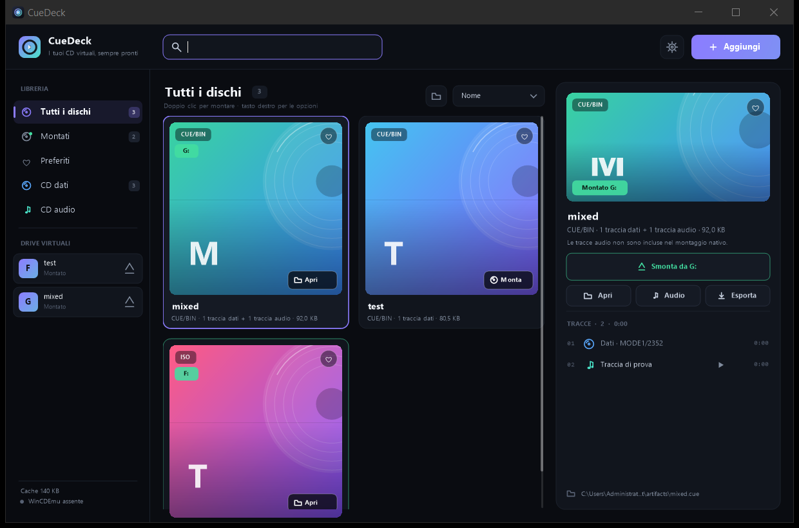
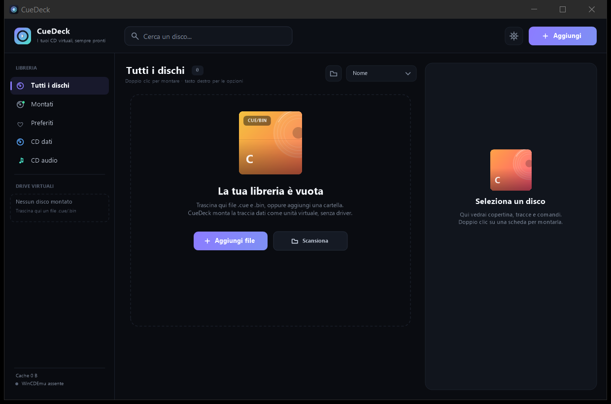
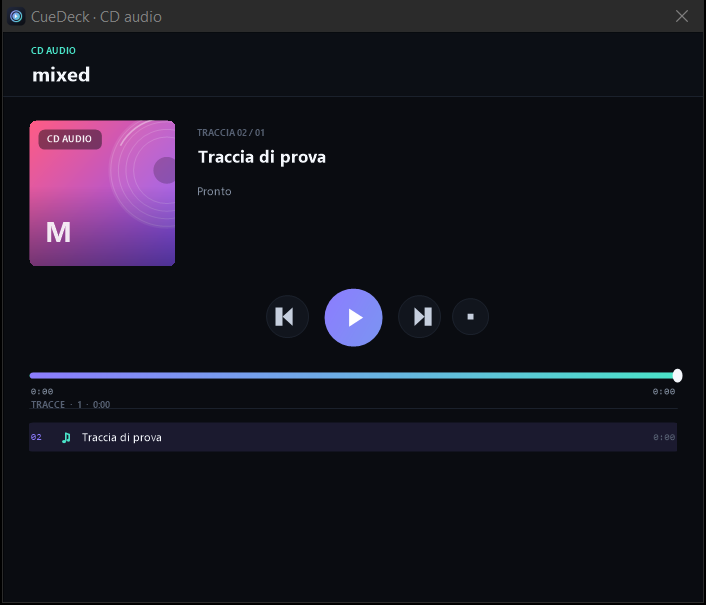

# CueDeck

**La libreria e il mounter di CD virtuali per Windows.** CueDeck apre i file `.cue` + `.bin` (e anche gli `.iso`) come unità CD virtuali, senza installare driver e senza richiedere privilegi di amministratore per i CD dati.




## Indice

- [Caratteristiche](#caratteristiche)
- [Requisiti](#requisiti)
- [Download e avvio](#download-e-avvio)
- [Guida rapida](#guida-rapida)
- [Come funziona il montaggio](#come-funziona-il-montaggio)
- [Modalità nativa e modalità completa](#modalità-nativa-e-modalità-completa)
- [Formati supportati](#formati-supportati)
- [Guida all'interfaccia](#guida-allinterfaccia)
- [CD audio](#cd-audio)
- [Scorciatoie](#scorciatoie)
- [Riga di comando](#riga-di-comando)
- [Dati, cache e privacy](#dati-cache-e-privacy)
- [WinCDEmu (opzionale)](#wincdemu-opzionale)
- [Risoluzione problemi](#risoluzione-problemi)
- [Limiti noti](#limiti-noti)
- [Compilare dai sorgenti](#compilare-dai-sorgenti)
- [Struttura del progetto](#struttura-del-progetto)
- [Test](#test)
- [Roadmap](#roadmap)
- [Licenza e crediti](#licenza-e-crediti)

## Caratteristiche

- **Montaggio nativo dei CD dati.** La traccia dati di un `.cue`/`.bin` viene convertita in un'ISO nella cache e collegata con l'API Virtual Disk di Windows (`virtdisk.dll`). Nessun driver di terze parti, nessun servizio, nessun riavvio.
- **Più CD virtuali insieme.** Ogni disco montato riceve una lettera di unità dedicata: puoi montare più giochi o archivi contemporaneamente, come con un lettore CD reale.
- **Libreria curata.** Trascina i file nella finestra, cerca, filtra per CD dati/audio, ordina, aggiungi ai preferiti, imposta una copertina e rinomina i dischi.
- **CD audio integrati.** I dischi audio non hanno un file system da montare: CueDeck legge le tracce dal CUE/BIN, le riproduce con il player integrato e le esporta in WAV.
- **Tray e avvio singolo.** Chiudi la finestra e CueDeck resta nella tray mantenendo i dischi montati. Una sola istanza gestisce tutti i file aperti da Esplora file.
- **Cache gestita.** Le ISO temporanee e le anteprime audio si trovano in `%LOCALAPPDATA%\CueDeck` e si possono cancellare dalle impostazioni.
- **Snella e portatile.** Un solo `.exe` da circa 214 KB, .NET Framework 4.8 (incluso in Windows 11), nessuna dipendenza esterna.
- **Nessuna telemetria.** CueDeck non contatta server: tutta la libreria e le impostazioni restano sul PC.

## Requisiti

| Componente | Requisito |
|---|---|
| Sistema | Windows 10 o Windows 11 (64 bit consigliato) |
| Runtime | .NET Framework 4.8 o 4.8.1 (incluso in Windows 11) |
| Permessi | Nessun admin per il montaggio dei CD dati |
| Spazio | Circa 1 MB per l'app; la cache ISO dipende dai dischi montati |
| Driver | Nessuno per la modalità nativa; WinCDEmu opzionale per la modalità completa |

## Download e avvio

### Versione compilata

- **`dist/CueDeck.exe`** — applicazione portable, nessuna installazione.
- **`dist/CueDeck-1.0.zip`** — archivio con exe, README, licenza e screenshot.
- **[Releases](https://github.com/FSMaker77/CueDeck/releases)** — la release `v1.0.0` contiene gli stessi file scaricabili singolarmente.
- **Hash SHA-256** — in `dist/SHA256SUMS.txt` e negli asset della release.

CueDeck è portatile: puoi copiare `CueDeck.exe` dove preferisci. La libreria e le impostazioni vengono salvate in `%LOCALAPPDATA%\CueDeck`, non accanto all'exe.

> L'exe non è firmato digitalmente. Se Windows SmartScreen mostra un avviso, scegli **Ulteriori informazioni → Esegui comunque**. Il codice sorgente completo è in questo repository.

### Primo avvio

1. Apri `CueDeck.exe`.
2. Trascina nella finestra uno o più file `.cue`/`.bin` (o `.iso`).
3. Doppio clic su una scheda per montare il disco.
4. Apri l'unità dalla scheda, dalla barra laterale o dal toast di conferma.



## Guida rapida

### Aggiungere dischi

Puoi usare uno di questi modi:

- trascinare i file nella finestra;
- premere **Aggiungi → Aggiungi file…** (`Ctrl+O`);
- premere **Aggiungi → Aggiungi cartella…** per scansionare una cartella (fino a 5 livelli);
- aprire un file da Esplora file con `CueDeck.exe --mount "file.cue"`.

Quando aggiungi un `.cue`, CueDeck cerca automaticamente il `.bin` indicato nel file. Se aggiungi un `.bin` con un `.cue` nella stessa cartella, viene usato il CUE.

### Montare un disco

- **Doppio clic** sulla scheda: monta il disco (o apre l'unità se è già montato).
- **Monta disco** nel pannello di destra: monta la traccia dati.
- **Apri** sulla scheda/nel pannello: apre l'unità già montata.
- **Smonta da X:** nel pannello: smonta il disco selezionato.

Per smontare tutti i dischi: menu **Aggiungi → Smonta tutti**, oppure l'icona di espulsione accanto a ogni drive nella barra laterale.

### Più dischi contemporaneamente

Ogni montaggio crea un'unità CD-ROM separata con una lettera libera (per esempio `F:` e `G:`). La sezione **Drive virtuali** nella barra laterale mostra tutte le unità attive; da lì puoi aprire o espellere ogni disco.

### Cercare, filtrare, organizzare

- **Ricerca** in alto (`Ctrl+F`): cerca nel titolo, nel nome file, nell'autore e nei titoli delle tracce già lette.
- **Filtri**: Tutti i dischi, Montati, Preferiti, CD dati, CD audio.
- **Ordina**: Nome, Recenti, Ultimi montati, Dimensione.
- **Preferiti**: cuore sulla scheda o `Spazio`.
- **Copertina**: tasto destro → *Imposta copertina…* (JPG/PNG/BMP/GIF).
- **Rinomina**: tasto destro → *Rinomina…* oppure `F2`.
- **Rivela nel file system**: apre Esplora file sul file sorgente.

### Chiudere e tray

Con l'opzione predefinita, la **X** nasconde CueDeck nella tray e mantiene i dischi montati. Fai doppio clic sull'icona per riaprire. Da **Impostazioni** puoi disattivare questo comportamento. Per uscire davvero usa il menu della tray → **Esci**.

## Come funziona il montaggio

Un CUE/BIN è un'immagine di CD a settori grezzi. Per un CD dati CueDeck:

1. legge il file CUE e individua la traccia dati;
2. estrae i 2048 byte utili di ogni settore nella cache ISO;
3. collega l'ISO al sistema con l'API `virtdisk.dll` di Windows;
4. mantiene il disco collegato finché CueDeck resta in esecuzione.

La cache si trova in `%LOCALAPPDATA%\CueDeck\Cache`. La prima apertura di un disco richiede la conversione; le successive sono immediate finché sorgente e CUE non cambiano.

## Modalità nativa e modalità completa

| | Modalità nativa | Modalità completa (WinCDEmu) |
|---|---|---|
| Driver | Nessuno | Driver WinCDEmu |
| Admin | No | Può richiedere conferma UAC |
| Traccia dati | Sì | Sì |
| Tracce audio del CD misto | No (player/export separati) | Sì |
| CD audio puro come unità | No | Sì |
| Dischi con protezioni | Dipende dal file system | Più compatibile |
| Installazione | Nessuna | WinCDEmu opzionale |

La modalità nativa è il default per i CD dati. Se un disco ha tracce audio o un formato dati non supportato, CueDeck mostra le azioni disponibili e propone la modalità completa solo se WinCDEmu è installato.

## Formati supportati

| Formato | Supporto |
|---|---|
| `.cue` + `.bin` `MODE1/2352` | Montaggio nativo |
| `.cue` + `.bin` `MODE2/2352` | Montaggio nativo |
| `.cue` + `.bin` `MODE1/2048` | Montaggio nativo |
| `.cue` + `.bin` `MODE2/2048` | Montaggio nativo |
| `.cue` + `.bin` `MODE2/2336`, `CDI/2352` | Montaggio nativo |
| `.iso` ISO 9660 / UDF | Montaggio nativo |
| `.bin` senza CUE | Rilevamento automatico della modalità |
| CUE con più file, `INDEX 00/01`, `PREGAP` | Supportato |
| CUE con file WAVE per l'audio | Riproduzione/esportazione |
| CD audio puro | Player + export WAV |
| CUE con MP3/AIFF/MOTOROLA | Avviso; il player integrato non li supporta |

## Guida all'interfaccia

### Barra superiore

- **Cerca un disco…** — ricerca nella libreria.
- **Aggiungi** — file o cartella.
- **Ingranaggio** — impostazioni, WinCDEmu, cache, comportamento tray.

### Barra laterale

- Filtri della libreria con conteggi.
- **Drive virtuali**: lettera, titolo e pulsante di espulsione.
- Cache corrente e stato di WinCDEmu.

### Libreria

Ogni scheda mostra copertina (o arte generata), formato, numero di tracce, dimensione e stato di montaggio. Il bordo viola indica la scheda selezionata.

### Pannello di destra

- Copertina, titolo, autore e metadati.
- Pulsante principale: monta, riproduci, smonta o apri.
- Azioni secondarie: apri cartella, audio, export, montaggio completo.
- Elenco tracce con tipo, durata e play per le tracce audio.
- Percorso del file sorgente.



## CD audio

I CD audio non hanno un file system, quindi non possono essere montati come unità dati. CueDeck:

- mostra le tracce audio del CUE;
- estrae la traccia selezionata in un WAV temporaneo;
- la riproduce con il player integrato (play/pausa, stop, precedente/successiva, barra di avanzamento);
- esporta tutte le tracce in WAV in una cartella scelta.

Per montare un CD audio come vera unità virtuale serve WinCDEmu (modalità completa).

## Scorciatoie

| Tasto | Azione |
|---|---|
| `Ctrl+O` | Aggiungi file |
| `Ctrl+F` | Cerca |
| `Invio` | Monta/apri il disco selezionato |
| `Spazio` | Aggiungi/rimuovi dai preferiti |
| `F2` | Rinomina il disco selezionato |
| `Canc` | Rimuovi dalla libreria (con conferma) |
| `Esc` | Chiudi overlay o pulisci la ricerca |
| `←` `→` `↑` `↓` | Naviga tra le schede quando la ricerca non è attiva |
| `Spazio` nel player | Play/pausa |
| `←` `→` nel player | Traccia precedente/successiva |

## Riga di comando

CueDeck usa una sola istanza. Se è già aperto, i comandi vengono inviati all'istanza esistente.

```powershell
# Aggiunge un disco e mostra la finestra
CueDeck.exe "D:\Giochi\Gioco\disco1.cue"

# Aggiunge e monta subito
CueDeck.exe --mount "D:\Giochi\Gioco\disco1.cue"

# Aggiunge una cartella intera
CueDeck.exe "D:\Giochi\Raccolta"
```

Per associare i `.cue` a CueDeck, crea un collegamento/associazione con:

```text
"CueDeck.exe" --mount "%1"
```

## Dati, cache e privacy

CueDeck salva tutto localmente in `%LOCALAPPDATA%\CueDeck`:

| Percorso | Contenuto |
|---|---|
| `library.json` | Libreria, titoli, preferiti, copertine |
| `settings.json` | Impostazioni e dimensioni finestra |
| `Cache\` | ISO temporanee dei CD dati |
| `Preview\` | Anteprime WAV delle tracce audio |
| `Covers\` | Copertine importate |
| `Logs\` | Log locali in caso di errore |

Nessun dato viene inviato in rete. Dalle impostazioni puoi aprire la cartella dati o svuotare la cache (dopo aver smontato i dischi nativi).

## WinCDEmu (opzionale)

Per la modalità completa puoi installare [WinCDEmu](https://wincdemu.sysprogs.org/portable/) (gratuito, LGPL). CueDeck lo rileva automaticamente nei percorsi standard oppure puoi indicare l'eseguibile da **Impostazioni → WinCDEmu → Sfoglia**.

- La modalità completa può mostrare una richiesta UAC di Windows.
- WinCDEmu gestisce i propri dischi: se chiudi CueDeck senza smontarli, possono restare presenti finché non li espelli.
- CueDeck non include né ridistribuisce WinCDEmu.

## Risoluzione problemi

### Il disco dati non viene montato

- Verifica che il CUE punti a un BIN esistente.
- Controlla che la traccia dati sia in un formato supportato (vedi tabella).
- Se il file system non è ISO 9660/UDF, Windows non può montare l'ISO nativa: prova la modalità completa con WinCDEmu.
- Controlla il log in `%LOCALAPPDATA%\CueDeck\Logs\cuedeck.log`.

### Non appare la lettera di unità

Windows assegna una lettera libera al momento del montaggio. Se non ci sono lettere disponibili, libera un'unità o usa **Smonta tutti** e riprova.

### “Il disco è in uso”

Un'applicazione sta leggendo il disco. Chiudi l'applicazione e riprova; in alternativa riavvia CueDeck.

### SmartScreen o antivirus

L'eseguibile non è firmato. Puoi verificare l'hash SHA-256 nella release e usare **Ulteriori informazioni → Esegui comunque**. Se l'antivirus blocca l'eseguibile, aggiungilo alle eccezioni solo se ti fidi del sorgente.

### La riproduzione audio non parte

Alcuni sistemi non hanno un dispositivo MCI/WAV disponibile. CueDeck mostra un pulsante **Apri con Windows** per il file WAV estratto.

## Limiti noti

- La modalità nativa espone solo la traccia dati: le tracce audio di un CD misto non sono un file system.
- I CD audio puri richiedono WinCDEmu per il montaggio come unità virtuale.
- I formati audio esterni (MP3/AIFF/MOTOROLA) nei CUE non sono supportati dal player integrato.
- La modalità nativa richiede che Windows riconosca il file system dell'ISO (ISO 9660/UDF).
- La modalità completa dipende da WinCDEmu e dalla configurazione delle lettere di unità di WinCDEmu.

## Compilare dai sorgenti

Serve Windows con .NET Framework 4.8 e il compilatore `csc.exe` incluso nel framework.

```powershell
powershell -NoProfile -ExecutionPolicy Bypass -File .\build.ps1
```

Il build:

1. genera/aggiorna l'icona `assets/cuedeck.ico`;
2. compila tutti i file `src/*.cs` con `csc.exe`;
3. produce `dist/CueDeck.exe`;
4. crea `dist/CueDeck-1.0.zip` con exe, README, licenza e screenshot.

Requisiti di build: .NET Framework 4.8, `System.Web.Extensions.dll` (parte del framework). Nessun NuGet, nessun SDK aggiuntivo.

## Struttura del progetto

```text
CueDeck/
├─ src/
│  ├─ Program.cs              avvio, single instance, pipe
│  ├─ MainForm.cs             logica della finestra e comandi
│  ├─ MainForm.Render.cs      rendering custom dell'interfaccia
│  ├─ Theme.cs                colori, font, icone e disegno
│  ├─ UiPrimitives.cs         hotspot, menu scuro, cache immagini
│  ├─ CueParser.cs            parser CUE/BIN e metadati
│  ├─ IsoBuilder.cs           conversione traccia dati → ISO + cache
│  ├─ NativeMounter.cs         montaggio con virtdisk.dll
│  ├─ WinCDEmuMounter.cs       integrazione opzionale WinCDEmu
│  ├─ AudioTools.cs            estrazione WAV e player MCI
│  ├─ AudioPlayerForm.cs       player CD audio
│  ├─ Store.cs                libreria, impostazioni, copertine
│  ├─ Models.cs               modelli e formattazione
│  └─ app.manifest            DPI, long path, asInvoker
├─ assets/cuedeck.ico
├─ docs/screenshots/
├─ tests/CoreTests.cs         test del motore
├─ tools/MakeIcon.cs          generatore icona
├─ dist/                      exe e zip compilati
├─ build.ps1
├─ LICENSE
└─ README.md
```

## Test

I test del motore coprono:

- parsing di CUE dati, audio e multi-file;
- conversione ISO con confronto byte-per-byte;
- estrazione WAV ed export di tutte le tracce;
- rilevamento BIN standalone;
- montaggio nativo reale, lettura di un file dal disco e smontaggio.

Per ricompilare il test harness:

```powershell
$fw = "$env:WINDIR\Microsoft.NET\Framework64\v4.0.30319"
& "$fw\csc.exe" /nologo /codepage:65001 /out:tests\CoreTests.exe /langversion:5 `
  /r:System.dll /r:System.Core.dll /r:"$fw\System.Web.Extensions.dll" `
  tests\CoreTests.cs src\Models.cs src\CueParser.cs src\IsoBuilder.cs `
  src\Store.cs src\NativeMounter.cs src\AudioTools.cs

tests\CoreTests.exe "C:\percorso\artefatti-di-test"
```

## Roadmap

- gruppi multi-disco con cambio disco automatico;
- associazione `.cue`/`.iso` e installer con voce Start Menu;
- copertine da cartella o da un database locale;
- supporto CHD/7z e conversione batch;
- supporto `.mds`/`.ccd`/`.nrg`;
- tema chiaro e localizzazione;
- montaggio audio SCSI nativo senza driver.

## Licenza e crediti

Codice CueDeck: **MIT** — vedi [LICENSE](LICENSE).

WinCDEmu è un progetto separato di Sysprogs OÜ, distribuito con licenza LGPL. CueDeck non include né ridistribuisce il driver WinCDEmu. Le API Virtual Disk e MCI sono fornite da Windows.

CueDeck 1.0 — creato con .NET Framework 4.8 e WinForms.
